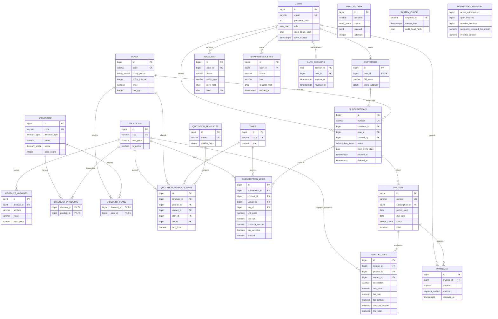

# Brightloop database ER diagram

`DASHBOARD_SUMMARY` is a view over subscriptions, invoices, and payments.
`SYSTEM_CLOCK` is a singleton coordination row and has no ordinary entity
relationship. Invoice-line descriptions and monetary/tax values are historical
snapshots; nullable catalog references are informational only.
